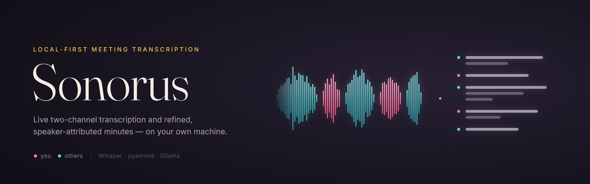

<p align="center"></p>

[English](README.md) · **Italiano**

Trascrizione delle riunioni **tutta in locale** su Windows: diretta mentre parli e, a fine riunione, un verbale rifinito con le voci separate e i nomi.

- **Diretta a due canali.** Cattura in loopback WASAPI ciò che esce dal PC ("Altri") e il microfono ("Io"), ognuno con il proprio segmentatore a energia e un filtro anti-eco. La trascrizione usa faster-whisper `large-v3-turbo` (int8_float16) sulla GPU.
- **Verbale rifinito.** Usa il motore di [Neon Minutes](https://github.com/battles5/neon-minutes) (pyannote + Whisper), installato a parte e guidato da `neon_worker.py` in un processo separato. La GPU (anche solo 4 GB) è di uno solo: la diretta ha la precedenza e la rifinitura si mette in pausa e riprende dalle cache.
- **La tua voce si riconosce da sola.** La traccia del microfono dice quando parlavi tu: lo speaker di pyannote che coincide con quei momenti prende il tuo nome ed entra nella libreria voci.
- **Diretta + verbale uniti** (`merge.py`). I tratti che la rifinitura salta vengono recuperati dalla diretta (in corsivo, «dalla diretta»). Le frasi di cortesia inventate sul silenzio ("Grazie a tutti.") vengono tolte, se la diretta non le conferma.
- **Pausa del microfono.** Pulsante o **Ctrl+Alt+M** globale, da usare insieme al mute di Teams: mentre è attiva la tua voce non viene né trascritta né salvata, e nel file al suo posto c'è silenzio. Gli intervalli di pausa sono scritti nella diretta.
- **Rifai la diretta.** Le due tracce restano salvate e si possono ritrascrivere più veloci del tempo reale, per esempio dopo aver aggiornato il glossario.
- **Unione parola per parola.** Dentro i paragrafi, le parole dei due sistemi vengono allineate. Dove non sono d'accordo vince il termine del glossario, oppure la versione con probabilità nettamente più alta: la diretta salva tempo e probabilità di ogni parola. Le correzioni sono elencate in fondo al verbale.
- **Verbale scritto dall'AI locale** (Ollama, per esempio `qwen3.5:9b`). A fine riunione scrive presenti, punti discussi, decisioni e azioni (chi, cosa, entro quando). Gira quando la GPU è libera e si interrompe se parte una diretta.
- **Riassunto «Finora» durante la riunione.** Ogni 5 minuti, con un modello piccolo sulla CPU.
- **Passaporta.** Si sceglie il progetto all'inizio della diretta: il suo glossario (nomi, partner, temi) va a Whisper e al verbale. Con «Manda a Passaporta» il verbale diventa una pagina in *Verbali* e le azioni diventano task nel Gantt. Rimandarlo aggiorna pagina e task, senza doppioni. Passaporta è l'app interna di wiki e Gantt; senza di lei tutto il resto funziona.
- **Segue il muto di Teams** tramite l'API locale per app di terze parti del nuovo Teams. Va attivata in Teams: Impostazioni → Privacy → Gestisci API.
- **Valutazione.** Si corregge a mano qualche minuto mentre lo si ascolta, e Sonorus calcola **WER e cpWER** di diretta, verbale rifinito, unione per tratti e unione parola per parola. Il totale su più riunioni si ottiene con `tools/valuta.py --riferimenti`.
- Glossario generale e per progetto, archivio, rinomina degli speaker, export in `.md`, `.json` e `.srt`.

## Prima valutazione

Su una riunione reale di 23 minuti con 6 persone, su una GPU da 4 GB:
- il verbale rifinito lasciava **senza testo il 5,4% del parlato**; l'unione con la diretta ha recuperato **+6,2% di parole**;
- il canale del microfono ha coperto il **99%** della voce dell'utente.

Dettagli e limiti in [`docs/valutazione.md`](docs/valutazione.md); si può rifare su altre riunioni con `tools/valuta.py`.

## Installazione

Serve Windows 10/11, Python 3.12 e una GPU NVIDIA (senza, si ripiega sulla CPU con il modello `small`). Per i verbali rifiniti serve Neon Minutes nella sottocartella `neon-minutes\`; vale anche l'installazione standard in `%LOCALAPPDATA%\Programs\Neon Minutes`, oppure la variabile `SONORUS_NEON`. Per il verbale scritto dall'AI e per i riassunti serve [Ollama](https://ollama.com).

```bat
install.bat
```

Crea `.venv`, scarica il modello e mette l'icona sul Desktop.

## File

| File | Cosa fa |
|---|---|
| `app.py` | Finestra pywebview, coda delle rifiniture, GPU condivisa, pausa microfono, hotkey |
| `engine.py` | Cattura, segmentatore, trascrittore, sessione, ritrascrizione dalle tracce |
| `merge.py` | Unisce diretta e verbale rifinito, per tratti e parola per parola (solo libreria standard) |
| `llm.py` | Verbale e riassunti con Ollama |
| `passaporta.py` | Progetti, glossario per progetto, invio del verbale e dei task |
| `teams.py` | Segue il muto di Teams (WebSocket locale su 127.0.0.1:8124) |
| `evalkit.py` | WER e cpWER sui tratti corretti a mano |
| `tools/valuta.py` | Statistiche di una sessione e totale dei riferimenti |
| `neon_worker.py` | Ponte verso Neon Minutes, con i fix per GPU da 4 GB |
| `static/index.html` | Interfaccia |

I dati restano sul PC: le riunioni in `Documents\Sonorus`, la configurazione e l'archivio in `%LOCALAPPDATA%\Sonorus`.

## Come citare

Sonorus è rilasciato con licenza MIT: puoi usarlo, modificarlo e ridistribuirlo liberamente. **Se lo usi**, o ne riprendi le idee (riconoscere la propria voce dal canale del microfono, unire diretta e verbale rifinito) in un lavoro, un prodotto o una pubblicazione, **ti chiedo di citarlo**. Il pulsante *Cite this repository* di GitHub (dal file `CITATION.cff`) produce il riferimento, per esempio:

```bibtex
@software{baldini_sonorus_2026,
  author  = {Baldini, Benedetta},
  title   = {Sonorus: local-first meeting transcription with two-channel live capture and refined minutes},
  year    = {2026},
  version = {1.1.0},
  url     = {https://github.com/bbaldini/sonorus},
  license = {MIT}
}
```

## Ringraziamenti

Il verbale rifinito usa [Neon Minutes](https://github.com/battles5/neon-minutes) (MIT-0), che si installa a parte. Le librerie principali sono [faster-whisper](https://github.com/SYSTRAN/faster-whisper), [pyannote.audio](https://github.com/pyannote/pyannote-audio), [PyAudioWPatch](https://github.com/s0d3s/PyAudioWPatch) e [pywebview](https://github.com/r0x0r/pywebview).
