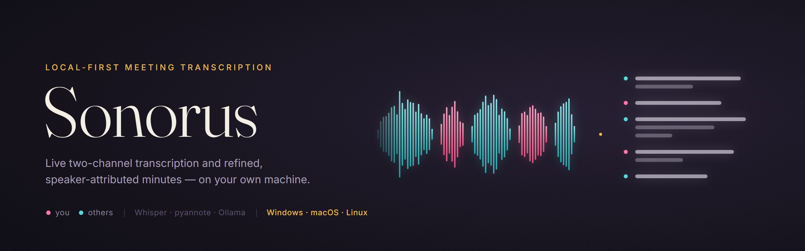

<p align="center"></p>

**English** · [Italiano](README.it.md)

Sonorus transcribes your meetings **entirely on your own computer**: Windows, macOS or Linux. You get a live transcript while you talk. When the meeting ends, it produces refined minutes with separate speakers and their names. Nothing leaves the machine: no cloud and no bot joining the call. It works with Teams, Zoom, Meet or anything else that plays through your speakers.

> The app's interface is in Italian (it was built for an Italian team); code comments and docs are mostly Italian as well. Transcription works in any language Whisper supports.

## What it does

- **Two-channel live transcription.** Sonorus captures what your computer plays ("others") and your microphone ("you"): WASAPI loopback on Windows, PulseAudio/PipeWire monitors on Linux, a virtual device such as BlackHole on macOS. Each channel has its own energy-based segmenter, and an echo guard stops the other people's voices from being attributed to you. Speech is transcribed with faster-whisper: `large-v3-turbo` (int8_float16) on an NVIDIA GPU, `small` on the CPU otherwise.
- **Refined minutes with speakers.** After the meeting, the [Neon Minutes](https://github.com/battles5/neon-minutes) engine (pyannote + Whisper over the whole recording) separates the voices and recognises people it has heard before. It runs in its own process. The GPU (4 GB is enough) is shared: a live session always wins, and a refinement in progress pauses and later resumes from its cache.
- **It recognises your voice without enrolment.** The microphone channel shows when *you* were speaking. The pyannote speaker that overlaps those moments takes your name and is added to the voice library.
- **Live + refined, merged.** The two transcripts fail in different ways: the live one cuts sentences every 20 s but rarely misses anything, while the refined one is clean but sometimes drops whole stretches and invents courtesy phrases over silence. `merge.py` uses each to repair the other:
  - **stretch level:** passages the refined minutes skipped are restored from the live transcript, in italics and marked as such; invented phrases the live transcript does not confirm are removed;
  - **word level:** inside each paragraph, the words of both systems are aligned. Where they disagree, the version containing a glossary term wins, or else the one with clearly higher confidence; the live transcript stores timing and probability for every word. Each correction is listed at the end of the minutes.
- **AI-written minutes on a local LLM** (Ollama, e.g. `qwen3.5:9b`). From the merged transcript it writes attendees, topics, decisions and action items (who, what, by when). It runs once the GPU is free and stops at once if a live session starts.
- **"So far" summary during the meeting.** Every 5 minutes, a small model running on the CPU updates a bullet summary, so it never competes with Whisper for GPU memory.
- **Mute that really mutes.** A button or a global **Ctrl+Alt+M** pauses your microphone: nothing is transcribed and the recording holds silence instead. Sonorus can also **follow Teams' own mute** via the new Teams' local third-party app API; enable it in Teams under Settings → Privacy → Manage API.
- **Projects and glossaries** (optional, via Passaporta, our internal wiki/Gantt app). You pick the project when the meeting starts, and its people, partners and topics become the glossary for Whisper and for the minutes. *Send to Passaporta* turns the minutes into a page and the action items into Gantt tasks. Sending again updates the same page and tasks instead of duplicating them. Everything else works without Passaporta.
- **Re-transcribe.** Both audio tracks are kept, so a meeting can be re-transcribed faster than real time, for example after you improve the glossary.
- **Built-in evaluation.** You listen to a few minutes and correct the text, and Sonorus computes **WER and cpWER** for each version: live, refined, stretch-merged and word-merged. Totals across meetings come from `tools/valuta.py --riferimenti`.

## First numbers

On a real 23-minute project meeting with 6 people, on a laptop GPU with 4 GB (no hand-made reference yet, so these are coverage figures, not error rates):

| | |
|---|---|
| Speech with **no text at all** in the refined minutes | **5.4 %** |
| Words recovered by merging with the live transcript | **+6.2 %** |
| User's voice covered by the microphone channel (vs. pyannote) | **99.2 %** |
| Refinement speed (diarization + ASR) | 0.15 × real time |
| AI minutes (`qwen3.5:9b`, partly on CPU) | 5–7 min |

Details and limitations are in [`docs/valutazione.md`](docs/valutazione.md) (Italian). To reproduce on your own meetings, run `tools/valuta.py`.

## Download and install

**[⬇ Latest release](https://github.com/bbaldini/sonorus/releases/latest)**: one package per system, each tested by GitHub Actions on every release. Unpack it and run the installer once; it sets up the Python packages, downloads the speech model and adds Sonorus to your apps.

| System | Package | Installer | Notes |
|---|---|---|---|
| **Windows** 10/11 | `Sonorus-windows.zip` | double-click `install.bat` | Python 3.12. Uses an NVIDIA GPU if present |
| **macOS** (Apple Silicon or Intel) | `Sonorus-macos.zip` | double-click `Installa Sonorus.command` | Python 3.10+. Runs on the CPU. macOS can't record system audio by itself: install the free [BlackHole](https://existential.audio/blackhole/) driver and create a *Multi-Output Device* (BlackHole + your headphones) in Audio MIDI Setup, then pick BlackHole as "others" |
| **Linux** x86_64 | `Sonorus-linux.tar.gz` | `./install.sh` | Python 3.10+ with `venv`, PulseAudio or PipeWire. Uses an NVIDIA GPU if present |

Optional:
- **Speaker-separated minutes** need [Neon Minutes](https://github.com/battles5/neon-minutes) (Windows and Linux; not available on macOS). Sonorus finds it in the `neon-minutes/` subfolder, in Neon's default install location (`%LOCALAPPDATA%\Programs\Neon Minutes` on Windows, `~/.local/lib/neon-minutes` on Linux), or wherever `SONORUS_NEON` points.
- **AI minutes and live summaries** need [Ollama](https://ollama.com) with a model such as `qwen3.5:9b` (minutes) and `qwen2.5:3b` (live summary).
- **Ctrl+Alt+M** works everywhere. On macOS it needs the Accessibility permission; on Linux it works under X11, while on Wayland you use the button.

Without Neon, everything else still works: live transcription, mic pause, AI minutes, Passaporta, evaluation.

## Files

| File | Purpose |
|---|---|
| `app.py` | pywebview window, refinement queue, shared GPU, mic pause, global hotkey |
| `engine.py` | Audio capture, segmenter, transcriber, session, re-transcription from saved tracks |
| `merge.py` | Merges live and refined transcripts, by stretch and word by word (standard library only) |
| `llm.py` | Minutes and live summaries via Ollama |
| `passaporta.py` | Projects, per-project glossary, sending minutes and tasks |
| `teams.py` | Follows Teams' mute state (local WebSocket on 127.0.0.1:8124) |
| `evalkit.py` | WER and cpWER on hand-corrected excerpts |
| `tools/valuta.py` | Session statistics and totals over references |
| `neon_worker.py` | Bridge to Neon Minutes, with fixes for 4 GB GPUs |
| `static/index.html` | User interface |
| `install.bat`, `install.sh`, `Installa Sonorus.command` | Installers for Windows, Linux/macOS, macOS (double-click) |
| `tests/selftest.py` | Cross-platform self-test run by CI |

All data stays on your computer. Meetings are saved in `Documents/Sonorus`; settings and the archive are in `%LOCALAPPDATA%\Sonorus` (Windows), `~/Library/Application Support/Sonorus` (macOS) or `~/.local/share/sonorus` (Linux).

## Citing

Sonorus is MIT-licensed: use it, change it and redistribute it freely. **If you use it**, or build on its ideas (recognising the user's voice from the microphone channel; merging live and refined transcripts), in a product, a project or a publication, **please cite it**. GitHub's *Cite this repository* button generates the reference from `CITATION.cff`:

```bibtex
@software{baldini_sonorus_2026,
  author  = {Baldini, Benedetta},
  title   = {Sonorus: local-first meeting transcription with two-channel live capture and refined minutes},
  year    = {2026},
  version = {1.2.0},
  url     = {https://github.com/bbaldini/sonorus},
  license = {MIT}
}
```

## Acknowledgements

Refined minutes rely on [Neon Minutes](https://github.com/battles5/neon-minutes) (MIT-0), installed separately. Sonorus is built on [faster-whisper](https://github.com/SYSTRAN/faster-whisper), [pyannote.audio](https://github.com/pyannote/pyannote-audio), [PyAudioWPatch](https://github.com/s0d3s/PyAudioWPatch), [pywebview](https://github.com/r0x0r/pywebview) and [Ollama](https://ollama.com).
